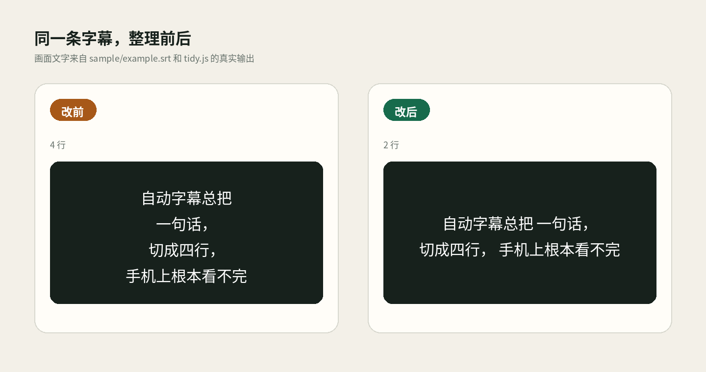

# CaptionTidy

Auto-generated SRT files often turn one phone screen into three or four cramped lines.
Open `index.html`, drop in your own SRT files, and CaptionTidy rewrites them as calmer two-line captions.
Everything runs locally in the browser; there is no upload, account, server, or build step.



## Install

Download or clone the folder. There is nothing to install and no `npm install` step.

Double-click `index.html`. A current desktop version of Chrome, Edge, Firefox, or Safari is enough.

## Use it

1. Choose one or more UTF-8 `.srt` files, or drag them onto the file picker.
2. Leave the defaults at 14 characters and 800 ms, or adjust them for your layout.
3. Compare the original on the left with the cleaned result on the right.
4. Download one result, or use **导出全部** to download the batch.

The line breaker prefers Chinese and common sentence punctuation, then spaces, then a hard character boundary. A short cue can merge into the next nearby cue; the first start time and final end time are kept.

The checked-in example is not a mock. Generate it again with:

```bash
node scripts/make-demo.js
python3 scripts/render-demo.py
```

`scripts/make-demo.js` runs the same `tidy.js` used by the page. It writes [demo/example.tidy.srt](demo/example.tidy.srt), and the Python script renders the real before/after text shown above.

## Test the algorithm

Node is only needed to run tests, not to use the page.

```bash
node test.js
```

The assertions cover long captions, punctuation-first wrapping, whitespace and no-punctuation fallbacks, short-cue merging, empty input, malformed blocks, BOM/CRLF input, and SRT serialization. No test framework or package download is involved.

## Limits

- Input is treated as UTF-8. Old GBK or Big5 subtitle files need to be converted before importing.
- Text is never discarded. If one cue is longer than twice the chosen limit, the second line stays long and the report marks it as over limit.
- **导出全部** starts several normal browser downloads. Some browsers may ask for permission to allow them.

CaptionTidy does not transcribe, translate, edit timing, process video, or call any network service.

## License

MIT. See [LICENSE](LICENSE).

